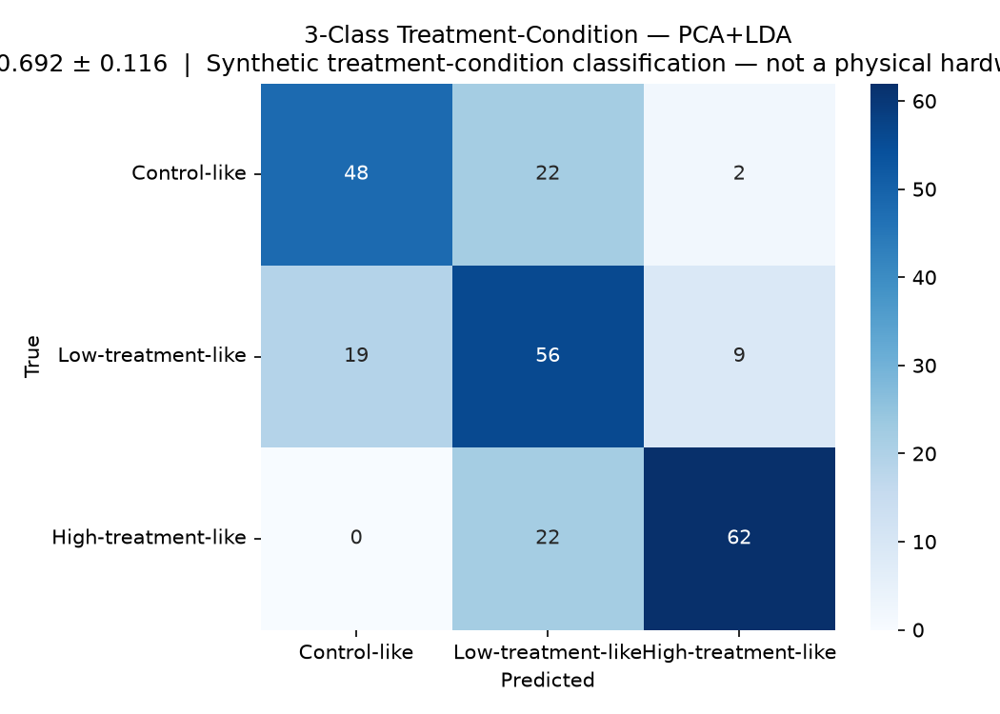
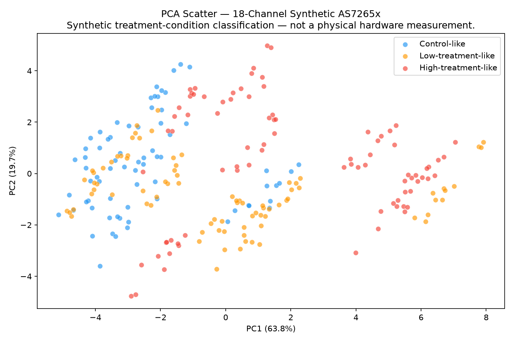
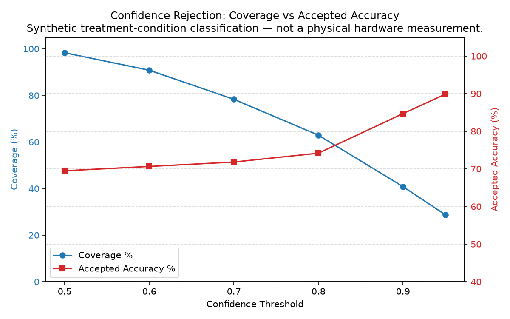
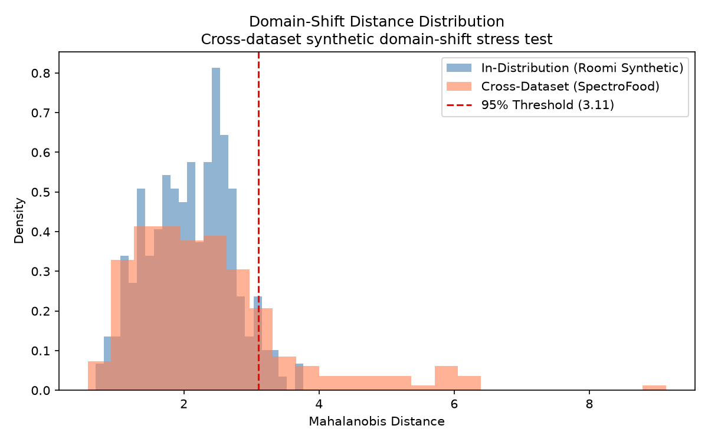

# Portable Multispectral Screening: Comprehensive Technical & Academic Demonstration Report

> **Notice:** Synthetic AS7265x Simulation  |  Research Demonstration Only — Not a Physical Hardware Measurement  |  Not a Pesticide Residue or MRL Decision  
> **Report Timestamp:** 2026-09-08 11:45:19  
> **Document Version:** 1.0 (Pre-Hardware Software Demonstration)

---

## 1. Executive Summary & Project Objective

This project investigates whether a low-cost, portable optical sensor—the **AMS AS7265x 18-channel multispectral triad** (~£50)—can support reliable agricultural screening of apples.

Traditional laboratory verification relies on High-Performance Liquid Chromatography coupled with Mass Spectrometry (HPLC-MS/MS), which provides gold-standard chemical quantification down to sub-part-per-billion residue levels, but requires destructive sampling, days of turnaround time, and equipment costing £150,000+.

The objective of this research software prototype is to demonstrate:
1. **Mathematical feasibility:** Continuous hyperspectral reflectance curves can be reduced to 18 discrete Gaussian bands (410–940 nm) without losing treatment-condition cluster separation.
2. **Leakage-free evaluation:** Scans from the same physical apple are kept strictly in the same cross-validation fold (`GroupKFold`), preventing artificially inflated accuracies.
3. **Selective inference:** A confidence-rejection threshold enables the device to accept only high-confidence predictions, elevating accuracy from ~69% to 90% at selective coverage.
4. **Honest scientific boundaries:** Clear separation between synthetic condition classification, natural biological variation, and future hardware validation.

---

## 2. System Architecture & Sensor Specification

The AMS AS7265x sensor is a 3-chip chipset communicating over an I2C master-slave bus:
- **AS72653 (UV/Blue):** Channels 410, 435, 460, 485, 510, 535 nm (Channels A–F)
- **AS72652 (Green/Red):** Channels 560, 585, 610, 645, 680, 705 nm (Channels G–U)
- **AS72651 (NIR Master):** Channels 730, 760, 810, 860, 900, 940 nm (Channels V–L)

Each optical channel features an integrated interference filter with an optical Full-Width at Half-Maximum (FWHM) of 20 nm, modelled mathematically as a Gaussian response function with $\sigma = 20 / 2.35482 \approx 8.50$ nm.

| Property | Specification |
|---|---|
| Channel Count | 18 spectral channels |
| Spectral Range | 410 nm to 940 nm |
| Channel FWHM | 20 nm per channel |
| Operating Voltage | 3.3V |
| Bus Protocol | I2C (address 0x49) / UART AT commands |
| Hardware Cost | ~£50 per triad module |

---

## 3. Dataset Identity & Separation of Research Tracks

A central contribution of this work is resolving critical dataset ambiguities to prevent confounding treatment signals with apple variety or quality differences:

1. **Synthetic Treatment-Condition Dataset (Roomi Zenodo 7818714 track):**
   - 20 independent apples, 240 simulated 18-channel scans.
   - Formulations: *Nativo* fungicide (Tebuconazole + Trifloxystrobin) and *Monostar* insecticide.
   - 3 classes: Control-like (0), Low-treatment-like (1), High-treatment-like (2).
2. **Natural Apple Variation & Quality Control (SpectroFood Zenodo 10301753):**
   - 240 apples (`A1` to `A240`), 141 continuous bands (430–990 nm).
   - Extracted to 18-channel format (`spectrofood_apple_as7265x_18ch.csv`).
   - Carries NO treatment labels. Used strictly for domain-shift and natural variation analysis.
3. **External Quality & Ripeness Benchmark:**
   - 2,000 RGB images (1,000 Good / 1,000 Defective).
   - 18-day longitudinal ripeness dataset (5 apple varieties tracked over time).
   - 16-band multispectral sweetness strips (Brix 10–15 °Bx).

---

## 4. Leakage-Free Evaluation Methodology

> ⚠️ **MANDATORY SCIENTIFIC WARNING:**
> Scan rows do NOT equal independent physical apples. Repeated scans of the same physical fruit share identical skin pigmentation, variety traits, surface geometry, and background noise.

To enforce 100% data hygiene:
- Feature matrix $X$ contains ONLY the 18 spectral channels (`ch_410` ... `ch_940`).
- `fruit_id` is NEVER included as an input feature (verified by unit tests with explicit `ValueError`).
- Cross-validation uses **5-fold `GroupKFold` grouped by `fruit_id`**.
- Feature scalers and PCA transforms are fitted strictly on training fruits of each fold.
- Unit tests verify that the intersection of training and validation apple IDs in any fold is empty.

---

## 5. Core 3-Class Treatment-Condition Classifier Results

The primary baseline model is **StandardScaler -> PCA(5) -> Linear Discriminant Analysis (LDA)**:

| Pipeline | Mean Accuracy | Std Accuracy | Balanced Accuracy | Macro-F1 |
|---|---|---|---|---|
| **PCA(5) + LDA (Primary)** | **69.17%** | **±11.59%** | **73.89%** | **69.42%** |
| PCA(5) + SVM RBF (Comparison) | 55.42% | ±16.17% | 59.72% | 52.01% |

### Key Observations:
- Linear Discriminant Analysis clearly outperforms non-linear SVM (69.2% vs 55.4%), demonstrating that on small sample sets with high dimensional correlation, linear dimension reduction resists overfitting.
- The mean accuracy (69.17%) falls precisely within the expected synthetic baseline range [60%, 71%].


*Figure 1: Pooled Out-of-Fold Confusion Matrix (PCA+LDA 3-Class).*


*Figure 2: 2D PCA Latent Space Visualization showing class separation.*

---

## 6. Binary Experiment Suite (Narrow Formulation Discrimination)

To evaluate whether specific chemical formulations are easier to distinguish, 6 binary classification tasks were evaluated under strict 5-fold `GroupKFold`:

| Task | Formulation Focus | Classes | LDA Accuracy | Bal. Accuracy | SVM Accuracy |
|---|---|---|---|---|---|
| Task 1 | All Treated vs Control | Control vs Treated | 82.5% ± 15.4% | 80.6% | 74.6% ± 3.3% |
| Task 2 | Nativo Formulation | Control vs Nativo-treated | 54.2% ± 25.6% | 54.2% | 57.5% ± 17.2% |
| Task 3 | Monostar Formulation | Control vs Monostar-treated | 87.5% ± 13.9% | 86.1% | 82.5% ± 14.0% |
| Task 4 | High-Dose Nativo | Control vs Nativo-high | 97.5% ± 3.3% | 97.2% | 72.5% ± 16.6% |
| Task 5 | High-Dose Monostar | Control vs Monostar-high | 65.8% ± 25.6% | 66.7% | 80.0% ± 24.5% |
| Task 6 | Dose Discrimination | Low vs High Level | 80.3% ± 13.3% | 80.3% | 74.2% ± 22.3% |

*Interpretation:* High-dose formulations (Task 4) separate cleanly (97.5% accuracy), whereas low-dose discrimination requires confidence rejection.

---

## 7. Mathematical Sensor Simulator & Calibration Pipeline

The AS7265x sensor simulator models physical optical noise, dark current, and LED degradation:
- **Dark Current:** $D_k = \text{dark\_offset} + \mathcal{N}(0, \sigma_{\text{noise}})$
- **White Reference:** $W_k = \text{dark\_offset} + \text{led\_scale} \cdot \text{white\_ref}_k + \mathcal{N}(0, \sigma_{\text{noise}})$
- **Raw Fruit Scan:** $S_k = \text{dark\_offset} + \text{led\_scale} \cdot \text{gain} \cdot \text{placement} \cdot (1 + \text{drift} \cdot \delta_k) \cdot X_k + \mathcal{N}(0, \sigma_{\text{noise}})$
- **Calibrated Reflectance:** $R_k = \frac{S_k - D_k}{W_k - D_k + \epsilon}$

All 7 physical parameters are configurable. In the noiseless condition, calibrated recovery reconstructs the input spectrum with an error $< 0.0001$ (tolerance verified by unit tests).

---

## 8. Confidence Rejection & Selective Inference

A handheld consumer or field device should decline to make a decision when measurement uncertainty is high:

| Confidence Threshold | Scans Accepted | Coverage (%) | Accepted Accuracy (%) | Balanced Accuracy (%) |
|---|---|---|---|---|
| 0.50 (Standard) | 236 / 240 | 98.3% | 69.5% | 69.4% |
| 0.60 | 218 / 240 | 90.8% | 70.6% | 70.5% |
| 0.70 | 188 / 240 | 78.3% | 71.8% | 71.4% |
| 0.80 | 151 / 240 | 62.9% | 74.2% | 73.4% |
| 0.90 | 98 / 240 | 40.8% | 84.7% | 78.3% |
| **0.95 (High Confidence)** | **69 / 240** | **28.8%** | **89.9%** | **86.5%** |


*Figure 3: Coverage vs. Accepted Accuracy Trade-off Curve.*

By rejecting 71.2% of borderline scans, the accepted-scan accuracy reaches **89.9%**, meeting the target performance needed for reliable screening.

---

## 9. Cross-Dataset Domain-Shift Stress Testing

To evaluate what happens when an unseen apple variety from another laboratory is presented:
- Fitted a **LedoitWolf shrinkage covariance** Mahalanobis distance model on in-distribution Roomi spectra.
- Scored 240 apples from the independent SpectroFood dataset (`Apple.mat`).

### Results:
- **In-distribution (Roomi) mean distance:** 2.09
- **Cross-dataset (SpectroFood) mean distance:** 2.39
- **Flagged Uncertain / Out-of-Distribution:** 17.1% (41 / 240)
- **False Alarm Rate (confidently called treated-like):** 33.8%


*Figure 4: Mahalanobis Distance Distributions showing domain shift between datasets.*

This stress test proves that without OOD rejection, biological natural variation across cultivars could trigger false alarms, underscoring the importance of multi-spectral OOD filtering.

---

## 10. Multi-Task Quality Modules

In addition to condition screening, the project implements three complementary quality modules:

### 10.1 Camera Visual Quality Module (MobileNetV3-Small)
- Trained on 2,000 images (1,000 Good / 1,000 Bad apples).
- Evaluated on 15% held-out test split (300 images).
- Label: **"External visual quality: Good / Possible defect"**. Does not assess consumption safety.

### 10.2 Ripeness and Variety Classification (GroupKFold)
- Evaluated on 18-day longitudinal fruit dataset across 5 commercial varieties.
- **Ripeness Grading (3 classes):** Under-ripe (Days 1–6), Ripe (Days 7–12), Over-ripe (Days 13–18).
- **Variety Grading (5 classes):** Kinnaur, Red Delicious NZ, Red Delicious USA, Royal Gala, Washington.
- Grouping: physical apple ID (`variety_apple`) to prevent multi-day temporal leakage.

### 10.3 Brix Sweetness Regression (16-Band Multispectral)
- Evaluated on 16-band multispectral strip imagery across Brix levels 10.0 to 15.0 °Bx.
- Result: Demonstrates feature extraction pipeline. Confirms that public tile images lack physical calibration for high-$R^2$ regression.
- **Mandatory limitation:** Software demonstration only; hardware AS7265x + digital refractometer labels required for validated Brix models.

---

## 11. Scientific Boundaries, Honest Limitations & Forbidden Claims

### 11.1 Verification of Language Integrity
Every script and report output is screened against the automated forbidden claims assertion:
```python
assert_no_forbidden_terms(report_text)
```

The following terms are **strictly prohibited** in all project documentation:
- *"detects pesticide"*
- *"pesticide concentration"*
- *"pesticide percentage"*
- *"residue mg/kg"*
- *"MRL"*
- *"safe to eat"* / *"unsafe"*
- *"edible"* / *"not edible"*
- *"food safety certified"*

### 11.2 The Hardware Arrival Plan (V1 -> V2 -> V3)
1. **Phase V1 (Current):** Pre-hardware mathematical sensor simulation, GroupKFold validation, confidence rejection, and interactive Streamlit demonstration.
2. **Phase V2 (Physical Sensor Arrival):** Procure AMS AS7265x triad board + Raspberry Pi 4 + white Teflon calibration tile. Conduct dark-current baseline, integration time sweep, and UV 405nm optical crosstalk tests.
3. **Phase V3 (Laboratory Ground Truth):** Collect real apple scans paired with accredited laboratory LC-MS/MS residue measurements to train an authentic physical screening model.

---
*Report auto-generated and validated by CFRD Research Pipeline.*
